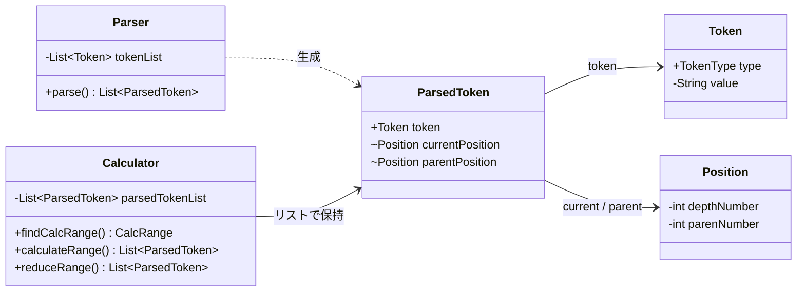
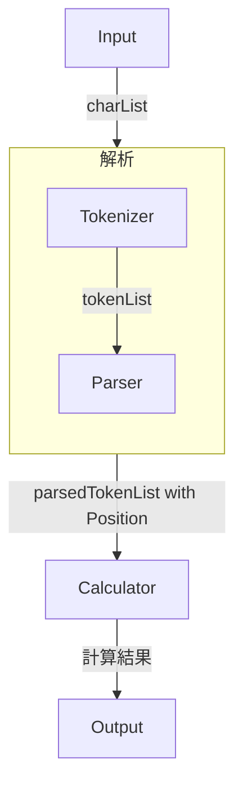

# Calculator

Java 11による、四則演算と括弧付き数式に対応できるコンソール電卓です。

## 〈概要〉

数式を1文字ずつ入力し、字句解析・構文解析・計算処理を経て結果を表示します。

既存の数式評価ライブラリやAST（抽象構文木）、逆ポーランド記法は使用せず、トークンの階層情報とリストの縮約によって演算子の優先順位および括弧の入れ子を処理する方式を設計しました。

## 〈主な機能〉

- 四則演算（加算・減算・乗算・除算）と結果の表示
- 演算子の優先順位への対応（乗算・除算 → 加算・減算）
- 括弧および多重括弧への対応
- 小数の入力と計算
- "BigDecimal" による数値計算

## 〈動作環境〉

- Java 11

## 〈クラス図 -要点-〉

- このアルゴリズムの要であるクラスの内容です。Token、計算式中の現在のPosition、親のPositionを、parsedTokenが保持します。Calculatorは、このparsedTokenのListを受取り、CalcRangeは（）後ろから検索し計算範囲を決定し、reduceRangeはその範囲を縮約しながら、最終的に計算結果を導きます。



## 〈処理の流れ〉


### Input

コンソールから数式を1文字ずつ受け取り、文字のリストを生成します。

### Tokenizer

連続した数字を数値として組み立て、数式を数値・演算子・括弧などのトークンに分解します。

### Parser

各トークンに括弧の深さや所属する階層を表す "Position" を付与します。括弧には親階層の情報も保持します。

### Calculator

最も深く、右側にある括弧を探索し、その範囲内で乗除算、加減算の順に処理します。
「計算済みの数式を単一の数値トークンへ縮約し親階層へ戻す」処理を繰り返します。
すべての括弧を処理した後、最上位階層の計算を行います。

### Output

計算結果を "BigDecimal" で扱い、"toPlainString()" によってコンソールに表示します。

## 〈実行例〉

入力は1文字ごとにEnterキーで確定します。

入力する数式例: 「 2+(3*4+(3+7*3)+3)+2= 」
出力される結果: 「      Answer: 43      」

## 〈設計上の工夫〉

1. 処理の責務分割

入力処理、字句解析、構文解析、計算処理、出力処理を別々のクラスに分割しました。

2. 括弧の階層管理

"Position" に括弧の深さと識別番号を持たせ、入れ子になった数式の計算順序を管理しています。

3. トークンリストの縮約

ある括弧の計算済みの式をひとつの数値トークンに置き換えることで、段階的に数式を簡略化し最終的に計算結果を得ます。

4. 数値精度への配慮

浮動小数点数の丸め誤差を避けるため、"BigDecimal" を使用しています。除算には "MathContext.DECIMAL64" を指定しています。

## 〈今後の課題〉

- 不正な数式に対する入力の検証と例外処理
- コンソール入力の操作性改善
- 自動テストの追加
- リスト探索や縮約処理の計算効率改善

## 〈開発目的〉

Javaのクラス設計、コレクション、データ構造、アルゴリズムへの理解を深めるために制作しました。
数式の解析方法と計算順序の制御を設計し実装することを目指しました。

## 〈実行方法〉

動作環境
- Java 11以降（JDK）
- ターミナル

1. リポジトリの取得

```bash
git clone https://github.com/hiokakko-eng/java_calculator.git
cd java_calculator
```
2. コンパイルと実行

```bash
javac -d out src/*.java
java -cp out CalculatorApp
```
3. 使用方法

起動後、数式を1文字ずつ入力し、その都度Enterキーを押してください。最後に=を入力すると計算結果が表示されます。

```text
2
+
3
*
4
=
Answer: 14
```
※エラー処理は実装していないため、数式は正しく入力してください。


